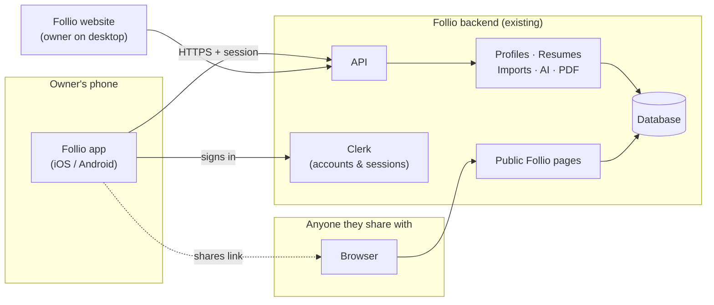
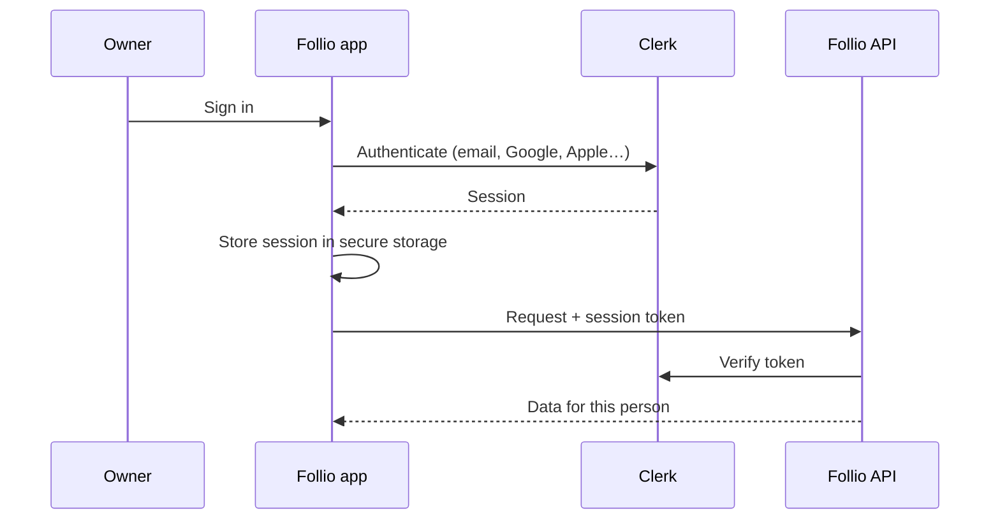

# Follio App — Engineering Brief

**Audience:** the engineers building the Follio app for iOS and Android
**Status:** kickoff. Nothing is built yet.
**Purpose:** agree on what we are building, the stack, and the system design before the first line of code.

---

## 1. What we are building

Follio is a person's professional identity, shared through one link.

Today Follio is a website. People build their profile, keep one or more resumes, bring in material from their resume, GitHub, or LinkedIn, and share a single Follio link. Whoever opens that link meets them: who they are, how to reach them, their resume, and their work.

We are now building the Follio app for iOS and Android. It is Follio on the phone, not a companion or a lite version. Over time it should do most of what the website does.

### The focus: sharing a professional identity

A phone is where people actually meet each other: at a conference, after an interview, over coffee, in a message thread. That is the moment Follio exists for.

So the app is designed around one question: **how fast and how well can someone hand over who they are?**

Everything else in the app — building the profile, editing it, managing resumes, importing material — exists so that the identity being shared is good. Those features matter, but they serve the share.

### Product principles

1. **Sharing is one step away from anywhere.** Your Follio, and the way to send it, are never buried.
2. **One identity, everywhere.** The app and the website are two windows onto the same profile. A change in one appears in the other.
3. **The recipient needs nothing.** People who receive a Follio open it in their browser. We never ask them to install the app.
4. **Native, not a wrapped website.** The app should feel like it belongs on the phone, and should use what the phone does well.
5. **Trust by default.** People are sharing who they are. Visibility must be obvious, and nothing becomes public by accident.

---

## 2. Key decisions

These are settled. If you want to revisit one, raise it before building against it.

| #   | Decision                                                | Why                                                                                                                                  |
| --- | ------------------------------------------------------- | ------------------------------------------------------------------------------------------------------------------------------------ |
| D1  | **One app for iOS and Android**, from a single codebase | Two engineers, one product. Two separate native apps would double the work and split the team.                                       |
| D2  | **Expo (React Native) with TypeScript**                 | Same language and paradigm as the website. Real native UI. Expo handles builds, signing, store submission, and over-the-air updates. |
| D3  | **A new repository**, separate from the website         | The app and the website release on different schedules and have different toolchains. Keeping them apart keeps both simple.          |
| D4  | **The existing Follio backend is the backend**          | Accounts, profiles, imports, AI, public pages, and PDFs already exist. The app is a new client, not a new system.                    |
| D5  | **The app never talks to the database directly**        | All data goes through the API. One set of rules, enforced in one place.                                                              |
| D6  | **Same accounts as the website**                        | One person, one login, on any device.                                                                                                |
| D7  | **The public Follio stays on the web**                  | Recipients open a link in a browser. The app is for the owner.                                                                       |
| D8  | **UI is built fresh for mobile**                        | Web components don't run on phones. We rebuild screens natively and match the Follio brand, not the web layout.                      |

### Alternatives we considered

- **Flutter.** A strong toolkit, but it uses Dart. We'd be running a second language next to a TypeScript product, and we'd still be rewriting every screen. No advantage for us.
- **Separate Swift and Kotlin apps.** Best platform fidelity, but two codebases for two engineers is not sustainable at this stage.
- **Wrapping the website in a web view.** Fast to ship, but it would feel like a website in a box, miss native sharing entirely, and likely struggle in App Store review.
- **A monorepo with the website.** Not ruled out forever. If sharing types between the two becomes painful, we can move later. It is not worth the setup cost on day one.

---

## 3. Tech stack

### Core

| Layer          | Choice                                                | Notes                                                                                             |
| -------------- | ----------------------------------------------------- | ------------------------------------------------------------------------------------------------- |
| Framework      | **Expo** (latest SDK), React Native                   | Managed workflow. Use development builds, not Expo Go, once native modules are in.                |
| Language       | **TypeScript**, strict mode                           | Same standard as the website.                                                                     |
| Navigation     | **Expo Router**                                       | File-based routes. Also gives us deep links and universal links almost for free.                  |
| Auth           | **Clerk** (Expo SDK)                                  | Same Clerk application as the website.                                                            |
| Server state   | **TanStack Query**                                    | Caching, retries, background refresh, optimistic updates.                                         |
| Local state    | **Zustand**                                           | Only for UI state that isn't server data. Same library the website uses.                          |
| Forms          | **React Hook Form + Zod**                             | Same validation approach as the website, so errors match.                                         |
| Secure storage | **expo-secure-store**                                 | Session tokens live in the Keychain / Keystore, never plain storage.                              |
| Styling        | A single Follio theme (colors, type, spacing, radius) | NativeWind is acceptable if the team prefers utility styling. Pick one approach and stay with it. |

### Build and release

| Concern          | Choice                                                                            |
| ---------------- | --------------------------------------------------------------------------------- |
| Builds           | **EAS Build** — iOS and Android from the same project                             |
| Store submission | **EAS Submit** — App Store Connect and Google Play                                |
| Hotfixes         | **EAS Update** — JavaScript-only fixes without a store review                     |
| Environments     | Development, staging, production — each pointing at the matching backend          |
| CI               | Lint, typecheck, and tests on every pull request, matching the website's standard |

### Quality and operations

| Concern                   | Choice                                                           |
| ------------------------- | ---------------------------------------------------------------- |
| Crash and error reporting | Sentry (or equivalent), with no personal data in reports         |
| Unit tests                | Jest + React Native Testing Library                              |
| End-to-end tests          | Maestro, for the critical flows: sign in, edit, share            |
| Analytics                 | Only after we agree what we are measuring. Sharing events first. |

Libraries beyond this list are fine when they earn their place. Prefer Expo-maintained modules for device features.

---

## 4. System design

### 4.1 The big picture

There are three parties:

- **The owner on the app**, managing and sharing their identity.
- **The owner on the website**, doing the same from a laptop.
- **The recipient**, who opens a shared Follio in any browser.

Both owner clients talk to the same API and read the same profile. The recipient only ever sees public web pages.

### 4.2 Responsibilities

| Lives in the app                                            | Lives on the backend                           |
| ----------------------------------------------------------- | ---------------------------------------------- |
| Screens, navigation, gestures                               | Accounts and identity                          |
| Native sharing: share sheet, QR, contact card, and the like | Profiles, resumes, and all their sections      |
| Camera and file access for uploads                          | Visibility rules and who can see what          |
| Caching for speed and brief offline reading                 | Share links, unlisted keys, share tokens       |
| Secure storage of the session                               | Resume import, GitHub and LinkedIn connections |
| Push notification handling (later)                          | AI features                                    |
|                                                             | Public pages, resume rendering, PDF generation |

**The rule:** if it's a business rule, it lives on the backend. The app is responsible for presenting the product well, not for deciding what is allowed.

### 4.3 Authentication

- The app and the website use the **same Clerk application**, so one account works on both.
- Each device has its own session. Signing out on the phone does not sign out the website.
- Every request carries a short-lived session token. The backend verifies it and decides who is asking.
- The app holds **no server secrets**. It only knows the public Clerk key and the API address.
- **Sign in with Apple** is required on iOS if we offer other social sign-in options. Plan for it in Clerk from the start.

> **First technical milestone:** a real account signs in on a physical phone and loads its own profile from the API. The backend currently trusts sessions from the website; it has to be configured to accept the app's sessions too. Prove this before building features on top of it.

### 4.4 Data model, in plain terms

- A **person** has one account.
- A person can have **several resumes**. Each resume is a full profile: contact, summary, experience, education, skills, projects, and more.
- One of those is their **Follio** — the identity behind the link they share.
- Each surface (Follio, resume, work) has its own **visibility**: public, unlisted, or private.

The app never decides which profile is "active." It asks the backend, and asks the backend to switch. This keeps the phone and the website from disagreeing.

### 4.5 How data flows

**Reading.** Screens fetch through TanStack Query. Results are cached, so returning to a screen is instant, and refreshed in the background.

**Writing.** Edits are sent to the API. Show the change right away where it's safe (renaming, toggling), and roll back clearly if the server rejects it. For anything meaningful — publishing, changing visibility, deleting — wait for the server before confirming.

**Consistency.** The server is always the truth. Local cache is a convenience. After a save, the website shows the change on its next load, and vice versa.

**Offline.** The first version should let someone _open their Follio and share it_ with poor or no signal — that's the moment we exist for. Editing offline is not in scope initially.

### 4.6 The API contract

The website's API was built for the website. It will need work to serve a second client well. Expect to do three kinds of backend changes:

1. **Fill gaps.** Some website pages load data directly on the server and have no API equivalent. When the app needs that data, add a proper endpoint.
2. **Shape responses for mobile.** Where a screen would need five calls, consider one endpoint that returns what the screen needs.
3. **Make the contract explicit.** Shared request and response types, validated on the backend, mirrored in the app.

**Backward compatibility matters now.** A website update reaches everyone instantly. An app update doesn't — people run old versions for months. So:

- Don't remove or rename fields the app depends on. Add new ones.
- Add a **minimum supported app version** check, so we can ask outdated apps to update instead of letting them break.
- Consider versioning mobile-facing endpoints once the contract settles.

### 4.7 Sharing — the heart of the app

The shared artifact is always a **link to the public Follio on the web**. The backend owns that link. The app requests it and never builds URLs by hand, because visibility and unlisted keys change what the correct link is.

What the app should make effortless:

- **Send the link** through the system share sheet — Messages, WhatsApp, Mail, LinkedIn, anything.
- **Show a QR code** full-screen, bright, readable across a table.
- **Pick what to share**: the Follio, a specific resume, or the work page.
- **Be clear about visibility** before sharing. Sending a private Follio as if it were public is a bug.

Native capabilities worth exploring once the basics are solid, roughly in order of value:

| Capability                        | Why it fits Follio                                                       |
| --------------------------------- | ------------------------------------------------------------------------ |
| Save as contact card (vCard)      | The recipient adds you to their contacts in one tap.                     |
| Apple Wallet / Google Wallet pass | Your Follio QR is always one swipe away, even from the lock screen.      |
| Home screen widget                | Your QR on the home screen, without opening the app.                     |
| Universal links / app links       | A Follio link opens the app for its owner and the web for everyone else. |
| NFC tap-to-share                  | Phone-to-phone handoff at events.                                        |

Each of these should be scoped separately. None blocks the first release.

### 4.8 Deep links

Set up universal links (iOS) and app links (Android) on the Follio domain early. They let us:

- Open the app from emails and notifications.
- Return people to the app after an external sign-in or connection flow (Google, LinkedIn, GitHub).
- Send a Follio owner into their app when they tap their own link.

Recipients who don't have the app always land on the web page. That must never break.

### 4.9 Security and privacy

- Session tokens live only in secure storage.
- No secrets in the app bundle. Anything shipped in the app is public.
- No personal data in logs, analytics, or crash reports.
- All traffic over HTTPS.
- Destructive actions — deleting a resume, making something private, deleting the account — need confirmation.
- The App Store and Play Store require **account deletion from inside the app** and a privacy disclosure. Plan for both before the first submission.

---

## 5. Design direction

The app should look and feel like Follio, and feel native on each phone.

- **Brand.** Take the Follio mark, the indigo accent, the calm neutral surfaces, and the typography from the product. Build one theme in the app and use it everywhere, including dark mode.
- **Not a port.** The website's builder is a large desktop editor. On a phone, the same capabilities need a phone-shaped design: focused screens, one task at a time, thumb-reachable actions.
- **Platform manners.** Respect iOS and Android conventions for navigation, back behaviour, sheets, and haptics, while keeping the Follio identity consistent.
- **Accessibility.** Dynamic type, screen readers, sufficient contrast, and touch targets that work for everyone. Not a later pass.

The website is the reference for **what Follio does**. It is not the reference for **how the app looks**.

---

## 6. Scope

The app will grow to cover most of Follio. For planning, the product falls into these areas:

| Area                   | What it includes                                                          |
| ---------------------- | ------------------------------------------------------------------------- |
| **Identity & sharing** | Your Follio, its link, QR, visibility, and every way to send it           |
| **Profile**            | All the sections that make up a professional identity                     |
| **Resumes**            | Multiple resumes, choosing which is your Follio, previewing and exporting |
| **Capture**            | Bringing material in — resume upload, GitHub, LinkedIn — and reviewing it |
| **Getting started**    | Sign up and first-time setup on the phone                                 |
| **Account**            | Settings, sign out, delete account                                        |

Suggested order: **identity and sharing first**, then profile and resumes, then capture and onboarding. The exact release plan is for the team to propose once the foundation is in place.

Out of scope: internal and admin tools. Those stay on the website.

---

## 7. Getting started

**Foundation, before any feature work:**

1. Create the repository with Expo, TypeScript, Expo Router, lint, formatting, and CI.
2. Set up EAS with development, staging, and production profiles.
3. Integrate Clerk. Sign in with a real account on a physical iPhone and a physical Android phone.
4. Make the first authenticated API call and render real data. Resolve any backend trust configuration this uncovers.
5. Establish the theme, the API client, error handling, and a loading and empty state pattern that every screen will reuse.
6. Get an internal build into TestFlight and Google Play internal testing.

Once that works end to end, feature work starts with sharing.

---

## 8. Open questions

To answer as a team in the first weeks:

- **Minimum OS versions** for iOS and Android.
- **Sign-up on mobile at launch**, or sign-in only for existing Follio users first.
- **Imports on mobile**: which sources are worth supporting on a phone first.
- **Push notifications**: what would be worth notifying about (for example, someone viewed your Follio).
- **Analytics**: which sharing and engagement metrics define success.
- **Monorepo later**: at what point sharing types with the website justifies the move.

---

## 9. Working agreement

- The backend is the source of truth. If the app needs a new rule or a new field, it goes into the backend first.
- Backend changes needed by the app are made in the website repository, reviewed like any other change, and kept backward compatible.
- iOS and Android stay on one codebase. Platform differences are handled in small, contained places — not in a fork.
- Every screen ships with its loading, empty, error, and success states.
- Test on real devices, on both platforms, before calling anything done.
